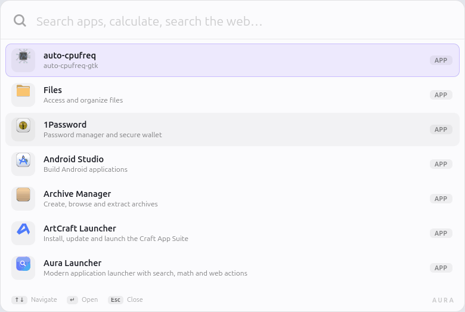
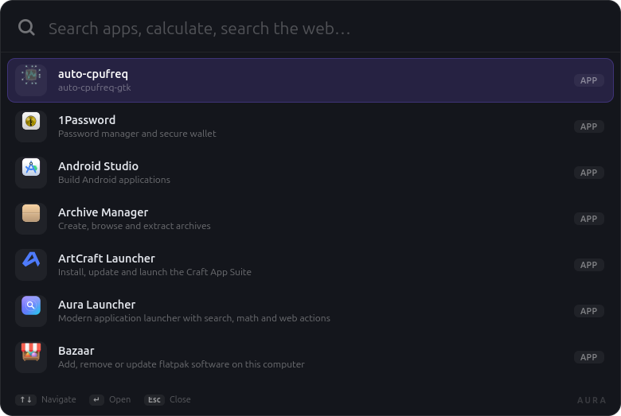
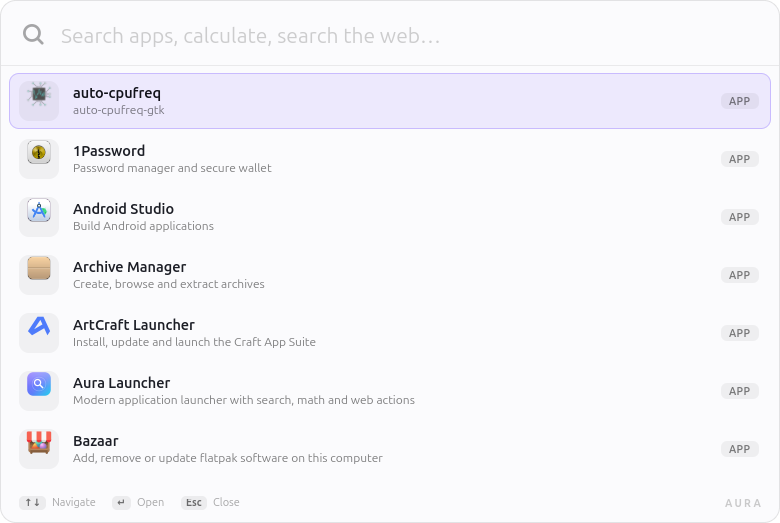

# Aura Launcher

[](https://github.com/zelimir86/aura-launcher-gtk/actions/workflows/ci.yml)
[](LICENSE)
[](https://gtk.org)

A modern application launcher for Linux — like Ulauncher, but with a cleaner
interface, smarter search, a built-in calculator and automatic dark/light theming.



<p align="center">
  
  
</p>

---

## Features

| Feature | Description |
|---|---|
| **App search** | Indexes every `.desktop` file and ranks by name, description, keywords and acronyms |
| **Learns your habits** | Counts launches and floats frequently used apps to the top |
| **Calculator** | Type `2^10 + sqrt(144)` and the result appears instantly; `Enter` copies it |
| **Web search** | `g`, `ddg`, `yt`, `gh`, `wiki`, `r`, `tr` prefixes |
| **Open URLs** | Paste `https://...` or just type `github.com` |
| **System actions** | `lock`, `sleep`, `reboot`, `shutdown`, `logout` |
| **Dark & light theme** | Follows the desktop setting live, no restart needed |
| **Adaptive height** | The window grows and shrinks with the number of results |
| **Keyboard driven** | `↑` `↓` to navigate, `Enter` to open, `Esc` to clear / close |

## Requirements

- Python 3.9+
- GTK 4 with PyGObject

```bash
# Debian / Ubuntu / Linux Mint
sudo apt install python3-gi gir1.2-gtk-4.0

# Fedora
sudo dnf install python3-gobject gtk4

# Arch
sudo pacman -S python-gobject gtk4
```

## Installation

```bash
git clone https://github.com/zelimir86/aura-launcher-gtk.git
cd aura-launcher-gtk
./install.sh              # install only
./install.sh --shortcut   # install and bind Super+Space (Cinnamon)
./install.sh --autostart  # install and keep a background instance at login
./install.sh --all        # shortcut + autostart
```

Everything is installed under `~/.local` — no root required:

```
~/.local/bin/aura-launcher
~/.local/share/aura-launcher/
~/.local/share/applications/org.aura.Launcher.desktop
~/.local/share/icons/hicolor/scalable/apps/org.aura.Launcher.svg
```

To remove it again:

```bash
./uninstall.sh
```

## Usage

```bash
aura-launcher          # open the launcher
aura-launcher --quit   # stop the background instance
aura-launcher --version
```

The app runs as a **single instance**: if it is already running in the
background, another invocation just brings the window up.

### Startup

Autostart is optional. Without it the first `Super+Space` starts the process
cold (~0.5 s) and it then stays alive in the background, so every later press
is instant. With autostart the very first press is instant too, at the cost of
a resident process (~50 MB PSS).

```bash
./install.sh --autostart     # enable
rm ~/.config/autostart/org.aura.Launcher.desktop   # disable
```

### Keyboard shortcut (Cinnamon)

`System Settings → Keyboard → Shortcuts → Custom Shortcuts`

| Field | Value |
|---|---|
| Name | Aura Launcher |
| Command | `aura-launcher` |
| Keybind | `Super+Space` |

GNOME: `Settings → Keyboard → Custom Shortcuts → +`, same values.

## Other desktops

Aura Launcher is a plain GTK 4 application and only relies on XDG standards,
so it runs on GNOME, KDE Plasma, XFCE, MATE, Budgie, Cinnamon, Sway, Hyprland
and anything else with GTK 4 available. It has been tested on Cinnamon under
Wayland.

### Keyboard shortcut

`./install.sh --shortcut` only automates Cinnamon. Elsewhere, bind
`aura-launcher` manually:

| Desktop | Where |
|---|---|
| GNOME | Settings → Keyboard → Custom Shortcuts → + |
| KDE Plasma | System Settings → Shortcuts → Custom Shortcuts → New → Global Shortcut → Command/URL |
| XFCE | Settings → Keyboard → Application Shortcuts → Add |
| MATE | Control Center → Keyboard Shortcuts → Add |
| Budgie | Settings → Keyboard → Custom Shortcuts |
| Sway | `bindsym $mod+space exec aura-launcher` |
| Hyprland | `bind = SUPER, Space, exec, aura-launcher` |

### Tiling window managers

GTK 4 cannot position its own windows, so a tiling compositor will tile the
launcher instead of floating it. Add a rule for the window class
`org.aura.Launcher`:

**Hyprland** (`~/.config/hypr/hyprland.conf`)

```
windowrulev2 = float,class:^(org.aura.Launcher)$
windowrulev2 = size 780 520,class:^(org.aura.Launcher)$
windowrulev2 = center,class:^(org.aura.Launcher)$
```

**Sway** (`~/.config/sway/config`)

```
for_window [app_id="org.aura.Launcher"] floating enable, resize set 780 520, move position center
```

**i3** (X11)

```
for_window [class="org.aura.Launcher"] floating enable, resize set 780 520, move position center
```

### Layer shell (experimental)

On wlroots compositors the launcher can use `wlr-layer-shell` to sit above
other windows and centre itself reliably:

```bash
# Debian / Ubuntu / Mint
sudo apt install gir1.2-gtk4layershell-1.0

AURA_LAYER_SHELL=1 aura-launcher
```

It is opt-in because it has not been verified on every compositor yet. Unset
the variable (or set it to `0`) to return to a normal window.

### System actions

`lock` and `logout` use `loginctl`, while `sleep`, `reboot` and `shutdown` use
`systemctl`. On distributions without systemd those entries will not work; the
rest of the launcher is unaffected.

### Icons

Icons come from the active icon theme using standard freedesktop names. A
minimal theme may not ship all of them; a missing icon renders blank instead of
breaking the row.

## Examples

```
fire                    → find Firefox
2*3+4                   → 10 (Enter copies the result)
g python gtk4 tutorial  → Google search
yt lo-fi beats          → YouTube search
github.com              → open the site
reboot                  → restart the machine
```

## Theming

The launcher follows the system preference and switches **live** — change the
desktop theme and the window repaints without a restart.

How the preference is detected:

| Source | Desktop |
|---|---|
| `color-scheme` key | GNOME 42+, KDE, XFCE 4.18+ |
| Theme name containing `dark` | Cinnamon, MATE |
| `Adw.StyleManager` | libadwaita |
| `gtk-application-prefer-dark-theme` | fallback |

Force a theme manually (handy for testing):

```bash
AURA_THEME=dark aura-launcher
AURA_THEME=light aura-launcher
```

## Project structure

```
aura_launcher/
├── app.py            # Gtk.Application and command line
├── window.py         # main window and UI logic
├── app_indexer.py    # .desktop indexing and ranking
├── calculator.py     # safe expression evaluation
├── web_search.py     # search providers and URL detection
├── system_actions.py # lock / suspend / reboot / shutdown / logout
├── theme.py          # dark/light detection and change tracking
├── style.css         # layout and structure
├── theme-dark.css    # dark palette
└── theme-light.css   # light palette
```

## Customization

**Colors** — `aura_launcher/theme-dark.css` and `theme-light.css`.
Each theme is a list of `@define-color` values; `style.css` only consumes them.
The accent is the `#7c5cff → #22d3ee` gradient on the calculator icon.

**New web searches** — `aura_launcher/web_search.py`, the `PROVIDERS` dict:

```python
"so": {"name": "Stack Overflow",
       "url": "https://stackoverflow.com/search?q={}",
       "icon": "utilities-terminal-symbolic"},
```

**New system actions** — `aura_launcher/system_actions.py`, the `ACTIONS` list.

**Visible results** — `MAX_LIST_HEIGHT` in `aura_launcher/window.py`.

## Development

```bash
python3 tools/test_logic.py        # logic tests, no display needed
python3 tools/smoke_test.py        # builds the window and checks searches
python3 tools/screenshot.py "" docs/preview.png
python3 tools/make_demo_gif.py     # regenerates docs/demo.gif
```

CI (GitHub Actions) runs the logic tests, builds the window under Xvfb and
syntax-checks the shell scripts.

## Acknowledgements

Developed with the help of an AI coding assistant (OpenCode).
The project idea, requirements, design decisions and testing were directed
by the author; the implementation was written collaboratively with the
assistant.

## License

MIT — see [LICENSE](LICENSE).
